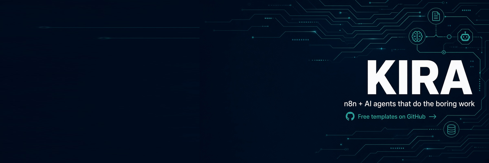

# Free n8n AI Agent Workflows for Founders (sample)

Two production-style n8n workflows that use any OpenAI-compatible LLM:

- **01 – AI Lead Qualifier → Slack**: scores form leads 0–100 and alerts you about the hot ones.
- **07 – Review Reply Agent**: brand-safe replies to customer reviews, with sentiment and an escalation flag.

## Quick start
1. Run n8n: `docker run -it --rm -p 5678:5678 -v n8n_data:/home/node/.n8n docker.n8n.io/n8nio/n8n`
2. **Import from File** → choose a JSON from `workflows/`.
3. Create a **Header Auth** credential (`Authorization` / `Bearer YOUR_KEY`) and select it on the **LLM** node.
4. Set `baseUrl` and `model` in **Config**, click **Test workflow**, then:
```bash
curl -X POST http://localhost:5678/webhook-test/review-reply -H 'Content-Type: application/json' \
  -d '{"business":"Brew Lab Cafe","review":"Coffee was great but waited 25 mins."}'
```

## Want all 10?
The **Founder AI Agent Pack** adds a support FAQ agent, cold email personalizer, invoice/GST extractor, daily competitor digest, meeting notes → actions, content repurposer, resume screener, weekly metrics narrator, and a full setup guide.
👉 Get the full pack: https://undefinedmahou.gumroad.com/l/qrxyln

MIT licensed (sample only).

## Follow along
- X: https://x.com/kira_automates
- Tutorial: https://dev.to/crzy_undefinedundefined/build-an-ai-lead-qualifier-in-n8n-in-15-minutes-free-workflow-4me1
